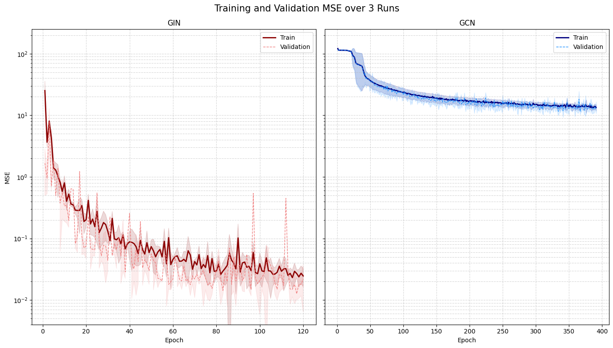

# GIN and GCN for Spectral Radius Prediction

Supervised graph regression with **Graph Isomorphism Networks (GIN)** and **Graph Convolutional Networks (GCN)**, using constant node features to predict the adjacency spectral radius of an undirected graph.

This project accompanies Giovanni Ufrasi's BSc thesis, *Graph Neural Networks: At the core of a Reinforcement Learning framework for Graph Theory conjectures*, University of Florence, academic year 2025/2026. The notebook implements the supervised comparison; the thesis discusses how graph representations can support reinforcement learning for graph construction.

[Read the notebook](gin_vs_gcn.ipynb) · [Read the thesis](thesis.pdf) · [Dataset instructions](dataset/README.md)

## Main results

The reported experiment uses 50,000 graphs sampled from the CuriosAI dataset, with one fixed split of 40,000 training, 5,000 validation, and 5,000 test graphs. All neural models use the same split and initialization seeds 42, 43, and 44.

| Model | Hidden width | Trainable parameters | Test MSE |
|---|---:|---:|---:|
| Constant training-mean baseline | — | — | 113.7849 |
| GCN | 64 | 8,513 | 11.4257 ± 0.8455 |
| GCN with approximately matched parameter count | 101 | 20,908 | 12.7500 ± 0.3478 |
| GIN with fixed epsilon equal to zero | 64 | 20,993 | 0.0089 ± 0.0026 |

Neural-network results are the mean and sample standard deviation across three seeds on the same test set. These values are transcribed from the original saved notebook outputs and rounded to four decimal places; the baseline has no seed-dependent standard deviation.



The figure is the original saved notebook output. Both panels share a logarithmic MSE scale. Within each architecture, histories are truncated to the shortest run before averaging, so every plotted point uses all three seeds. The displayed epochs differ from the best-checkpoint epochs used for test evaluation.

Machine-readable transcriptions are available in [results/summary.csv](results/summary.csv) and [results/run_metrics.csv](results/run_metrics.csv).

## Experimental setup

- **Input:** undirected edges and one constant feature per node, equal to 1.
- **Target:** adjacency spectral radius, read from `graph_features[6]` in each source JSON record.
- **Architectures:** three message-passing layers, global mean pooling, and a scalar prediction head. The main comparison uses hidden width 64 for both architectures; the additional GCN uses width 101.
- **Optimization:** Adam, learning rate 0.001, batch size 32, maximum 500 epochs, and early stopping after 50 epochs without a strict improvement in validation MSE.
- **Selection:** reload the checkpoint with the lowest validation MSE and evaluate it on the test set once per run.

## Project files

| Path | Purpose |
|---|---|
| `gin_vs_gcn.ipynb` | Data loading, models, training, plots, and saved results |
| `thesis.pdf` | Full BSc thesis |
| `requirements.txt` | Python dependencies |
| `dataset/README.md` | Dataset format and placement instructions |
| `figures/` | Figure extracted from the saved notebook output |
| `results/` | Rounded metrics transcribed from the notebook |
| `CITATION.cff` | Project citation metadata |

## Download and extract the dataset

The graph data is distributed as a compressed archive in the **Dataset v1** release, tagged `dataset-v1`, in this repository's **Releases** section.

1. Open **Releases**, select **Dataset v1**, and download the dataset archive from its assets.
2. Extract the archive on your computer before running the notebook.
3. Put the original JSON graph files directly in the repository's `dataset/` directory. If the archive already contains a folder named `dataset`, merge that folder with the existing one so that the final paths are `dataset/*.json`, rather than `dataset/dataset/*.json`.

Keep the original JSON filenames and contents unchanged. The notebook continues to use `dataset_dir = Path("dataset")` and reads the extracted JSON files; it does not open the compressed archive. See [dataset/README.md](dataset/README.md) for the expected format.

## Read the existing results

Open the notebook on GitHub to inspect its saved tables, logs, and figures. Reading the saved outputs does not require installing Python, downloading the dataset, or executing any cells.

The saved outputs come from the original experiments. Preparing the repository did not rerun training. The dataset and original binary experiment artifacts are separate from the notebook.

## Install and run locally

The original notebook records Python 3.12, PyTorch Geometric 2.6.1, Matplotlib 3.9.2, and an NVIDIA RTX 6000 Ada Generation GPU. PyTorch and scikit-learn versions were not recorded in the supplied setup output. The requirements pin the two recorded library versions and specify the remaining dependencies; they are not an exact lockfile of the original environment.

From the repository root on macOS or Linux:

```bash
python3 -m venv .venv
source .venv/bin/activate
python -m pip install --upgrade pip
python -m pip install -r requirements.txt
jupyter lab gin_vs_gcn.ipynb
```

On Windows, activate the environment with `.venv\Scripts\activate` before the installation commands. For a CUDA-specific PyTorch installation, follow the [official PyTorch installation selector](https://pytorch.org/get-started/locally/). The notebook selects CUDA when available and otherwise uses the CPU.

Keep the notebook's working directory at the repository root. If `dataset/` contains only its README, add the original JSON graph files as described in the [dataset instructions](dataset/README.md).

### Run new training

1. Run Sections 1–4 in order, including the constant baseline in Section 2.2.
2. Run Section 5.1 for the three GIN and three GCN runs.
3. Run Section 5.2 for the three wider-GCN control runs.
4. Skip Section 5.3 when plotting results from the models just trained. Their histories are already in memory, so continue with Section 6.

Sections 5.1 and 5.2 start substantial training jobs. A new experiment ID is generated each time; history archives and checkpoint files are written in the working directory. Section 7 records the original experiment and is not automatically updated after a new training run.

### Reload the original models

Section 5.3 is optional and targets the original main comparison. It requires the history archive `training_history_h64_lr1e-3_p50_87a8.pt` and the following six checkpoints beside the notebook:

| Checkpoint pattern | Seeds |
|---|---|
| `best_gin_h64_lr1e-3_p50_s{seed}_87a8.pth` | 42, 43, 44 |
| `best_gcn_h64_lr1e-3_p50_s{seed}_87a8.pth` | 42, 43, 44 |

With these original files available, run Sections 1 and 3, then Section 5.3 and the plotting cells in Section 6. Section 5.3 prints stored test metrics; it does not recompute test predictions.

The wider-GCN history archive is named `training_history_gcnpm_h101_lr1e-3_p50_26d0.pt`. It is separate from the main-comparison archive and is not loaded by Section 5.3. CSV summaries contain rounded metrics and cannot replace the original histories or trained weights.

## Interpretation and limitations

Under this protocol, GIN achieved substantially lower test MSE than either GCN configuration. Increasing GCN's parameter count did not close the observed gap. This is evidence about these architectures, data, and training settings; it does not isolate expressivity as the sole cause or establish general superiority on other tasks.

The experiment uses one split and three initialization seeds. The implemented GIN fixes epsilon at zero and uses a non-injective mean readout, so it does not automatically satisfy all assumptions for full 1-WL expressivity. The loader assumes the source dataset's stated non-isomorphism and target annotations; it does not independently verify them.

Reproducing the original sample also requires the original JSON contents, filenames, and graph order. Matching random seeds alone does not guarantee identical results across different environments or hardware.

## Author and references

**Giovanni Ufrasi**, University of Florence. Thesis supervisor: Prof. Maurizio Parton; co-supervisor: Prof. Andrea Frosini. Dataset attribution: CuriosAI, as documented in the thesis.

- [Full thesis](thesis.pdf)
- Xu et al., [How Powerful are Graph Neural Networks?](https://arxiv.org/abs/1810.00826), ICLR 2019.
- Kipf and Welling, [Semi-Supervised Classification with Graph Convolutional Networks](https://arxiv.org/abs/1609.02907), ICLR 2017.
- [PyTorch Geometric GINConv 2.6.1 documentation](https://pytorch-geometric.readthedocs.io/en/2.6.1/generated/torch_geometric.nn.conv.GINConv.html).
